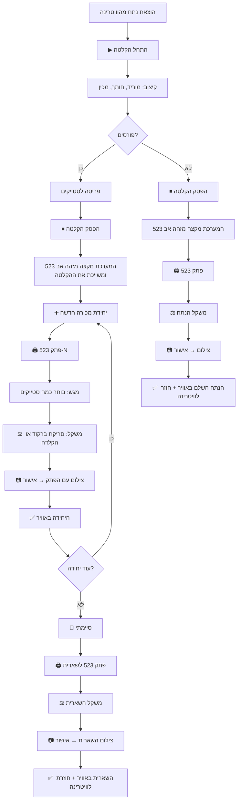
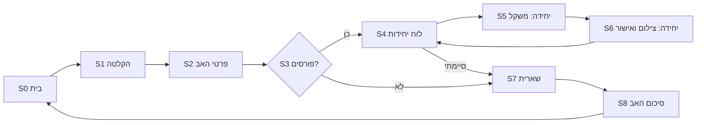

# SoloR — תהליך הקצב: מנתח אב ליחידות מכירה

> **מסמך:** `BUTCHER_FLOW.md` · גרסה 1.0 · 22.10.2026
> **מקור:** סרטון הדגמה של המייסד (22.10.2026) והבהרות בשיחה.
> **יחס ל־SPEC.md:** המסמך הזה **מחליף** את פרק 8 (מסכי הקצב) ואת כללי המלאי בפרקים 6.1, 6.3 ו־6.4 ב־SPEC.md. כל השאר ב־SPEC.md בתוקף. כשיש סתירה — המסמך הזה גובר.
> **לקלוד קוד:** קרא קודם את SPEC.md, אחר כך את המסמך הזה. פרק 9 כאן מפרט בדיוק מה משתנה בקוד.

---

## 1. הרעיון בשורה אחת

הקצב לוקח **נתח אב**, מקליט את הקיצוב, ומחלק אותו ל**יחידות מכירה** (מגשים) שכל אחת מקבלת **מזהה בן**, פתק ברקוד, משקל ותמונה. מה שנשאר חוזר לוויטרינה כ**שארית** עם מזהה האב. הלקוח רואה **עמוד אחד** לכל נתח אב, ובוחר ממנו יחידה מוכנה או כמות מהשארית.

---

## 2. שלושה סוגי מוצרים — מילון

| מונח | מזהה לדוגמה | מה זה פיזית | איך נמכר | מקור |
|---|---|---|---|---|
| **נתח אב** (Parent) | `523` | הנתח שהוצא מהוויטרינה וקוצב | לא נמכר בעצמו — הוא "העמוד" שמחבר הכל | מוקצה ברגע סיום ההקלטה |
| **יחידת מכירה** (Unit) | `523-1`, `523-2` | מגש עם מספר סטייקים שהקצב בחר | **כיחידה שלמה**, במחיר קבוע לפי המשקל שנשקל | הקצב לוחץ "יחידה חדשה" |
| **שארית** (Remainder) | `523` | הגוש שנשאר אחרי שהקצב סיים לחלק | **לפי משקל**: הלקוח מבקש כמות לפריסה, או קונה את כל השארית | הקצב לוחץ "סיימתי" |

**כלל זהב:** לכל פריט פיזי בוויטרינה יש פתק ברקוד, ולכל פתק יש פריט אחד במערכת. מזהה עם מקף (`523-1`) = יחידה. מזהה בלי מקף (`523`) = שארית / נתח שלם.

> **תצוגת המזהה:** בממשק ובפתקים המזהה מוצג כ־`SOL-523` / `SOL-523-1` (קידומת SoloR, תואם ל־SPEC). בטקסט הזה מקוצר ל־`523`.

---

## 3. התהליך המלא — תרשים



**סיכום התרחישים:**

| תרחיש | מה נוצר | דוגמה |
|---|---|---|
| **פורסים** | אב + N יחידות + שארית (אם נשארה) | `523` → `523-1` (3 סטייקים), `523-2` (2 סטייקים), `523-3` (3 סטייקים), שארית `523` |
| **לא פורסים** | אב בלבד, שנמכר לפי משקל — בדיוק כמו שארית | `523` — כל הנתח, הלקוח מבקש כמות לפריסה או קונה הכל |

> **שארית ונתח שלם הם אותו דבר במערכת:** שניהם "החלק של האב שנמכר לפי משקל". ההבדל רק אם קדמו לו יחידות.

---

## 4. כללים עסקיים

### 4.1 מזהים
- **R1.** מזהה אב מוקצה **ברגע לחיצה על "הפסק הקלטה"** (לא קודם). מספר רץ, ייחודי, לא חוזר.
- **R2.** מזהה יחידה = `{אב}-{מספר רץ}` החל מ־1, מוקצה **ברגע לחיצה על "יחידה חדשה"**.
- **R3.** אם יחידה בוטלה לפני פרסום — המספר שלה **לא ממוחזר** (523-2 נמחקה → הבאה היא 523-3). זה מונע בלבול עם פתק שכבר הודפס.
- **R4.** מזהה האב משמש גם כמזהה השארית. אין פתק נפרד לאב שאינו שארית.

### 4.2 משקל
- **R5.** משקל מוזן בשתי דרכים, לבחירת הקצב בכל פעם:
  - **סריקת ברקוד** ממדבקת המשקל הקיים בקצבייה (פרק 7);
  - **הקלדה ידנית** בגרמים, במקלדת מספרית גדולה.
- **R6.** משקל של יחידה הוא **סופי** — היחידה נמכרת כמו שהיא, במחיר = משקל × מחיר לק"ג.
- **R7.** משקל השארית הוא **יתרה משתנה** — מתעדכן במכירה מקוונת (גריעה) ובמכירה בחנות (שקילה מחדש, פרק 4.4).

### 4.3 פרסום
- **R8.** **אישור הצילום הוא אישור הפרסום.** אחרי הצילום מוצג מסך תצוגה מקדימה אחד עם כפתור "✅ אשר והעלה". לחיצה אחת = הפריט באוויר. (מקיים את החלטה 11 ב־SPEC — אין פרסום בלי אישור — בלי להוסיף שלב.)
- **R9.** פריט מתפרסם רק אם יש לו: תמונה מאושרת, משקל, מחיר לק"ג, ופרטי הנתח (סוג, גזע, ארץ מקור, יישון) — שנלקחים מהאב.
- **R10.** **פרטי הנתח מוזנים פעם אחת לאב** ועוברים בירושה לכל היחידות והשארית. הקצב לא מקליד אותם שוב לכל מגש.
- **R11.** **מחיר לק"ג נקבע פעם אחת לאב** ועובר בירושה. הקצב יכול לשנות מחיר ליחידה מסוימת לפני האישור (לחיצה על המחיר במסך התצוגה המקדימה).
- **R12.** הסרטון של הקיצוב מקושר לאב ומוצג בעמוד שלו. פרסומו לפיד הלקוחות דורש אישור נפרד (כפתור "פרסם סרטון" במסך סיכום האב) — ברירת מחדל: כן.

### 4.4 מלאי
| אירוע | יחידה (`523-1`) | שארית (`523`) |
|---|---|---|
| פרסום | זמינה | זמינה, יתרה = המשקל שנשקל |
| הזמנה מקוונת | נמכרה (כולה) | יתרה −= הכמות שהוזמנה (ראה R14) |
| ביטול הזמנה | חוזרת לזמינה | היתרה חוזרת |
| מכירה בחנות | סריקת הפתק → "נמכרה" | סריקת הפתק → שקילת מה שנשאר → הזנת **היתרה החדשה** (מחליפה, לא גורעת) |
| נגמרה | — | יתרה 0 או "נמכרה כולה" → אזלה |

- **R13.** **הזמנה מהשארית:** הלקוח בוחר אחת משתיים:
  - **"כל השארית"** — במשקל ובמחיר המוצגים;
  - **"פרוס לי"** — כמות בגרמים (צעדים של 50 גרם, מינימום 200), ואופציונלית עובי סטייק.
- **R14.** **מרווח ביטחון:** בהזמנת "פרוס לי" אפשר להזמין עד **95%** מהיתרה (5% נשמרים לסטיית חיתוך). קניית "כל השארית" — 100%. (תואם להחלטה 20 באפיון V4.)
- **R15.** הזמנה וגריעה עוברות רק דרך פונקציות DB אטומיות (כמו ב־SPEC 7.4). אין מכירה כפולה.

### 4.5 סשן עבודה
- **R16.** אפשר לעצור באמצע (טלפון צלצל, לקוח בדלפק) — הכל נשמר. במסך הבית מופיע "נתח בעבודה: 523 · 2 יחידות · המשך".
- **R17.** אפשר להתחיל נתח חדש רק אחרי סיום הנוכחי, או אחרי לחיצה מפורשת "השהה ופתח חדש". (מונע ערבוב יחידות בין נתחים.)

---

## 5. מסכי הקצב — מסך אחר מסך

> **עקרונות ממשק:** כפתורים בגובה 64px לפחות, טקסט גדול, פעולה ראשית אחת בכל מסך (כפתור צבעוני גדול בתחתית), מינימום הקלדה. הקצב עובד עם ידיים עסוקות.
> **פלטפורמה:** באב הטיפוס — טלפון (Web app). בהמשך — טאבלט בעמדה. אותו ממשק.

### מפת מסכים



---

### S0 — בית
**מטרה:** נקודת התחלה ומצב עבודה.
| אלמנט | תוכן |
|---|---|
| כפתור ראשי | **"▶ נתח חדש — התחל הקלטה"** |
| כרטיס "בעבודה" | אם יש נתח פתוח: "523 · אנטריקוט · 2 יחידות · **המשך**" |
| לשוניות | "בוויטרינה" (כל הפריטים הזמינים) · "הזמנות" (עם מונה) |
| פעולה מהירה | **"🔍 סרוק פתק"** — לסריקת פתק במכירה בחנות (S9) |

---

### S1 — הקלטה
**מטרה:** תיעוד הקיצוב והפריסה.
| אלמנט | תוכן |
|---|---|
| תצוגה | תצוגה חיה מהמצלמה + שעון רץ + נקודה אדומה "מקליט" |
| כפתור ראשי | **"⏹ הפסק הקלטה"** |
| משני | "⏸ השהה" / "▶ המשך" |
| בלחיצה על "הפסק" | המערכת **מקצה מזהה אב** ומציגה אותו בגדול: **"נתח 523"** (2 שניות) → S2. ההעלאה של הסרטון ממשיכה ברקע עם פס התקדמות קטן בראש המסך. |
| כשל | אם ההקלטה נכשלה — הודעה "ההקלטה לא נשמרה" + "המשך בלי סרטון" / "הקלט שוב". לא מתיימרים שיש תיעוד. |

> **אב טיפוס:** הקלטה דרך מצלמת הטלפון (`<input type="file" accept="video/*" capture>` או MediaRecorder). בשלב העמדה — מצלמה קבועה.

---

### S2 — פרטי האב
**מטרה:** להזין פעם אחת את מה שכל היחידות יירשו.
| שדה | קלט | ברירת מחדל |
|---|---|---|
| סוג נתח | 7 צ'יפים | — |
| גזע / מותג | צ'יפים מטבלת `breeds` + "אחר" | — |
| ארץ מקור | 6 צ'יפים | — |
| יושן? + ימים | מתג + צ'יפים 14/21/28/45 | — |
| מחיר לק"ג | מקלדת מספרית | המחיר האחרון לאותו סוג+גזע |

- **"מלא כמו הנתח הקודם"** — כפתור שמעתיק את כל הפרטים מהאב הקודם (חוסך הקלדה כשמקצבים כמה נתחים מאותו משלוח).
- אפשר לדלג ולהשלים מאוחר יותר — אבל **שום פריט לא יתפרסם** עד שהשדות מלאים (R9).
- כפתור ראשי: **"המשך"** → S3.

---

### S3 — פורסים?
**מטרה:** ההחלטה המרכזית.
שני כפתורי ענק בלבד:
- **"🔪 כן, מחלק ליחידות"** → S4
- **"🥩 לא, נמכר שלם לפי משקל"** → S7 (במצב "נתח שלם")

---

### S4 — לוח יחידות
**מטרה:** מרכז השליטה של החלוקה. הקצב חוזר לכאן אחרי כל יחידה.
| אלמנט | תוכן |
|---|---|
| כותרת | "נתח 523 · אנטריקוט בלאק אנגוס" |
| רשימה | כרטיס לכל יחידה: תמונה ממוזערת · `523-1` · 3 סטייקים · 1,240 גר' · ₪272.80 · ✅ באוויר |
| כפתור ראשי | **"➕ יחידת מכירה חדשה"** |
| כפתור משני גדול | **"🏁 סיימתי — השארית לוויטרינה"** → S7 |
| כפתור קטן | "אין שארית — הכל חולק" → S8 (בלי ליצור שארית) |

**בלחיצה על "יחידה חדשה":**
1. המערכת מקצה `523-N`.
2. מדפיסה פתק (או מציגה את המזהה בגדול — ראה פרק 8).
3. עוברת ל־S5.

---

### S5 — יחידה: משקל ותוכן
**מטרה:** משקל ומספר סטייקים.
| אלמנט | תוכן |
|---|---|
| כותרת | **"יחידה 523-2"** בגדול |
| מספר סטייקים | סטפר − / + (ברירת מחדל: כמו היחידה הקודמת). מוצג ללקוח. |
| משקל — אפשרות א׳ | **"📷 סרוק מדבקת משקל"** → פותח סורק → המשקל ממולא אוטומטית (פרק 7) |
| משקל — אפשרות ב׳ | שדה גרמים במקלדת מספרית גדולה |
| סיכום חי | "1,240 גר' × ₪220 = **₪272.80**" |
| כפתור ראשי | **"המשך לצילום"** (פעיל רק כשיש משקל) → S6 |
| משני | "בטל יחידה" (המספר לא ממוחזר — R3) |

---

### S6 — יחידה: צילום ואישור
**מטרה:** תמונה אמיתית + אישור = פרסום.
1. **צילום:** הקצב מניח את המגש עם הפתק בעמדת הצילום ולוחץ **"📷 צלם"** (באב הטיפוס: מצלמת הטלפון).
2. **תצוגה מקדימה** — כרטיס בדיוק כמו שהלקוח יראה: תמונה · "אנטריקוט בלאק אנגוס · 3 סטייקים" · 1,240 גר' · ₪272.80.
   - לחיצה על המחיר = שינוי מחיר ליחידה הזו (R11).
3. כפתורים:
   - **"✅ אשר והעלה"** (ראשי) → היחידה באוויר → חזרה ל־S4 עם הודעה "523-2 באוויר".
   - **"↺ צלם שוב"**.
   - **"+ עוד תמונה"** (רשות, עד 4).

---

### S7 — שארית / נתח שלם
**מטרה:** הגוש שחוזר לוויטרינה.
אותו רצף כמו יחידה, מקוצר:
1. המערכת מדפיסה פתק **`523`** (מזהה האב בלבד).
2. **משקל:** סריקה או הקלדה — זה המשקל הזמין למכירה.
3. **צילום** עם הפתק.
4. **תצוגה מקדימה:** "שארית אנטריקוט · 1,100 גר' · ₪220 לק"ג · אפשר לבקש פריסה" (במצב "נתח שלם": "אנטריקוט שלם · 2,400 גר'").
5. **"✅ אשר והעלה"** → S8.

---

### S8 — סיכום האב
**מטרה:** סגירה ואישור סרטון.
| אלמנט | תוכן |
|---|---|
| סיכום | "נתח 523 · 3 יחידות · שארית 1,100 גר' · סה"כ שווי ₪748" |
| רשימה | כל הפריטים עם סטטוס |
| סרטון | נגן + מתג **"פרסם את הסרטון לפיד"** (ברירת מחדל: מופעל) |
| בדיקת משקלים | "סכום משקלים: 3,400 גר'" (מידע בלבד, לא חוסם) |
| כפתור ראשי | **"✔ סיום — חזרה לבית"** |

---

### S9 — מכירה בחנות (מהבית, "סרוק פתק")
**מטרה:** לעדכן מלאי כשמוכרים בדלפק.
- סורקים פתק:
  - **יחידה (`523-1`)** → כרטיס היחידה + **"נמכרה בחנות"** → אישור → לא זמינה.
  - **שארית (`523`)** → כרטיס השארית + "כמה נשאר?" → סריקת מדבקת המשקל של מה שנשאר **או** הקלדה → אישור → היתרה מוחלפת. כפתור נוסף: "נמכרה כולה".

---

## 6. מה הלקוח רואה

### עמוד נתח אב (`/cut/523`)
```
┌─────────────────────────────────┐
│ ▶ סרטון הקיצוב                    │
│ אנטריקוט · בלאק אנגוס             │
│ 🇦🇷 ארגנטינה · יושן 28 יום          │
├─────────────────────────────────┤
│ יחידות מוכנות                     │
│ ┌──────┐ 523-1 · 3 סטייקים         │
│ │ תמונה │ 1,240 גר' · ₪272.80 [הזמן]│
│ └──────┘                          │
│ ┌──────┐ 523-2 · 2 סטייקים         │
│ │ תמונה │ 830 גר' · ₪182.60  [הזמן]│
│ └──────┘                          │
│ ┌──────┐ 523-3 · אזל               │
├─────────────────────────────────┤
│ מהשארית · 1,100 גר' · ₪220 לק"ג   │
│ ┌──────┐ ○ כל השארית — ₪242.00    │
│ │ תמונה │ ○ פרוס לי: [−] 600 גר' [+]│
│ └──────┘   עובי: [2 ס"מ ▾]        │
│            ≈ ₪132.00     [הזמן]   │
└─────────────────────────────────┘
```

- **בפיד:** כל פריט (יחידה או שארית) הוא כרטיס. לחיצה → עמוד האב, גלול לפריט.
- **מחיר "פרוס לי":** משוער לפי הגרמים שנבחרו, וננעל בהזמנה (כמו SPEC 6.3). הצגת הסבר: "החיתוך בפועל עשוי לסטות מעט".
- **פריט שאזל** נשאר מוצג באפור, בלי כפתור הזמנה.

---

## 7. ברקוד משקל — איך המשקל נקרא

מדבקות של משקלי קצבייה בישראל הן בדרך כלל ברקוד **EAN-13 שמתחיל ב־2** ("ברקוד במשקל משתנה"). המבנה **משתנה בין יצרני משקלים**, לכן הפענוח **חייב להיות מוגדר בהגדרות הקצבייה**, לא קבוע בקוד.

**מבנה נפוץ (דוגמה):**
```
2  1  12345  01240  7
│  │  │      │      └ ספרת ביקורת
│  │  │      └ משקל בגרמים (01240 = 1,240 גר')
│  │  └ קוד פריט במשקל
│  └ קוד סוג (משקל / מחיר)
└ קידומת משקל משתנה
```

**דרישות מימוש:**
- **W1.** הגדרה לכל קצבייה (`butchers.scale_barcode_config`, JSON):
  ```json
  { "prefix": "2", "value_type": "weight", "value_start": 7, "value_length": 5, "unit": "g" }
  ```
  `value_type` יכול להיות `"weight"` (גרמים) או `"price"` (אגורות) — אם המדבקה מקודדת מחיר, המשקל מחושב: מחיר ÷ מחיר לק"ג.
- **W2.** בדיקת ספרת ביקורת EAN-13. ברקוד לא תקין → הודעה "לא הצלחתי לקרוא — הקלד ידנית".
- **W3.** אחרי סריקה — **מציגים את המשקל שנקרא לאישור** (לא ממשיכים בשקט). הקצב יכול לתקן.
- **W4.** מסך הגדרה חד־פעמי "כיול ברקוד": הקצב סורק מדבקה אחת ומקליד את המשקל שמופיע עליה → המערכת מזהה אוטומטית איפה המשקל בברקוד ושומרת את ההגדרה.
- **W5.** סריקה:
  - **אב טיפוס (טלפון):** סריקה במצלמה — `BarcodeDetector` API כשקיים, ואחרת ספרייה (`@zxing/browser`).
  - **עמדה:** סורק USB שמתנהג כמקלדת — שדה קלט ממוקד שקולט הקשה מהירה ומסתיים ב־Enter.
- **W6.** אותו סורק משמש גם לסריקת **פתקי SoloR** (S9). מבחינים לפי הפורמט: פתק SoloR הוא QR עם `SOL-…`; מדבקת משקל היא EAN-13 שמתחיל ב־2.

---

## 8. פתקים (תוויות)

| פתק | מתי | מה עליו |
|---|---|---|
| יחידה | בלחיצה על "יחידה חדשה" | QR עם `SOL-523-2` + הטקסט `523-2` בגדול |
| שארית / שלם | בלחיצה על "סיימתי" / "לא פורסים" | QR עם `SOL-523` + הטקסט `523` בגדול |

- **אין משקל על הפתק** — המשקל במערכת (תואם למפרט הפיזי).
- **אב טיפוס בלי מדפסת:** אחרי הקצאת מזהה מוצג **מסך פתק** — המזהה בענק + QR — שאפשר לצלם/להעתיק בכתב יד על מדבקה. מימוש דרך ממשק `LabelOutput` עם שני מימושים: `ScreenLabel` (אב טיפוס) ו־`PrinterLabel` (עמדה, בהמשך).
- **התמונה ללקוח:** הפתק מופיע בתמונה כדי לקשר פיזית. **באב הטיפוס לא חותכים אותו מהתמונה** (זה בסדר — זה אפילו מחזק אמון). חיתוך אוטומטי — בהמשך.

---

## 9. שינויים בקוד מול SPEC.md (לקלוד קוד)

### 9.1 מודל נתונים — מחליף את `cuts` ב־SPEC 7.3

```sql
create type item_kind   as enum ('unit','remainder');
create type parent_status as enum ('recording','details','splitting','closed');

-- נתח אב: הישות שמחזיקה פרטים, מחיר וסרטון
create table parents (
  id                  uuid primary key default gen_random_uuid(),
  code                int  unique,                    -- 523; מוקצה ב-stop_recording
  butcher_id          uuid not null references butchers(id),
  status              parent_status not null default 'recording',
  split               boolean,                        -- true=פורסים, false=שלם
  cut_type            cut_type,
  breed_key           text references breeds(key),
  breed_other         text,
  origin_country      origin_country,
  is_aged             boolean,
  aging_days          int,
  aging_method        aging_method,
  description         text,
  price_per_kg_agorot int,
  video_path          text,
  video_published     boolean not null default true,
  next_unit_no        int not null default 1,         -- R2/R3: לא ממוחזר
  created_at          timestamptz not null default now(),
  closed_at           timestamptz
);
create sequence parent_code_seq start 1;

-- פריט מכירה: יחידה או שארית
create table items (
  id                  uuid primary key default gen_random_uuid(),
  parent_id           uuid not null references parents(id),
  butcher_id          uuid not null references butchers(id),
  kind                item_kind not null,
  unit_no             int,                            -- רק ל-unit; null לשארית
  label               text not null,                  -- '523-2' / '523'
  steak_count         int,                            -- רק ל-unit
  weight_g            int,                            -- unit: סופי; remainder: יתרה
  price_per_kg_agorot int,                            -- ברירת מחדל מהאב, ניתן לשינוי (R11)
  weight_source       text check (weight_source in ('scan','manual')),
  status              cut_status not null default 'draft', -- draft/published/sold_out/withdrawn
  published_at        timestamptz,
  created_at          timestamptz not null default now(),
  unique (parent_id, unit_no),
  check ((kind = 'unit') = (unit_no is not null))
);
create unique index one_remainder_per_parent on items(parent_id) where kind = 'remainder';
```

- `cut_media` → מקושר ל־`items` (תמונות) ול־`parents` (סרטון).
- `orders`:
  - מקבל `item_id` במקום `cut_id`;
  - `mode` ∈ `('unit','remainder_all','remainder_slice')`;
  - `requested_g` ו־`slice_thickness_cm` להזמנת "פרוס לי".
- `stock_events` → מקושר ל־`items`.
- `butchers.scale_barcode_config jsonb` (פרק 7).
- **מוסר מ־SPEC:**
  - `sale_mode`, `steak_weight_g`, `steaks_total`, `steaks_available`, `whole_available`;
  - הסליידר של משקל סטייק. החלוקה עכשיו פיזית ונעשית על ידי הקצב.

### 9.2 פונקציות DB (מחליפות את SPEC 7.4 בצד הקצב)
| פונקציה | מה עושה |
|---|---|
| `start_parent()` | יוצר אב בסטטוס `recording`, בלי `code` |
| `stop_recording(parent_id, video_path)` | מקצה `code` מה־sequence, `status='details'` |
| `set_split(parent_id, split bool)` | `split=true` → `splitting`; `split=false` → יוצר מיד item מסוג `remainder` |
| `new_unit(parent_id)` | נועל את האב, `unit_no = next_unit_no++`, יוצר item `draft` עם label `523-N` |
| `cancel_unit(item_id)` | רק `draft`; מוחק, **לא** מחזיר את המספר |
| `create_remainder(parent_id)` | יוצר item `remainder` (אחד בלבד לאב) |
| `publish_item(item_id)` | בודק R9 (תמונה, משקל, מחיר, פרטי אב) → `published` |
| `close_parent(parent_id, video_published)` | `closed`; דורש שאין items ב־`draft` (או מציע לבטלם) |
| `place_order(item_id, mode, requested_g, …)` | unit → כל היחידה; `remainder_all` → כל היתרה; `remainder_slice` → `requested_g ≤ floor(weight_g × 0.95)` |
| `store_sale(item_id, new_weight_g \| null, sold_all bool)` | יחידה → `sold_out`; שארית → `weight_g = new_weight_g` (החלפה) |

כל הפונקציות אטומיות עם `FOR UPDATE`, לפי הכללים ב־SPEC 7.4.

### 9.3 נתיבים
```
/butcher                       S0
/butcher/parent/new            S1 (יוצר אב ומתחיל הקלטה)
/butcher/parent/[id]           מנתב לפי status: details→S2, splitting→S4, closed→S8
/butcher/parent/[id]/details   S2 + S3
/butcher/parent/[id]/units     S4
/butcher/item/[id]/weigh       S5
/butcher/item/[id]/photo       S6 (ומשמש גם לשארית)
/butcher/parent/[id]/remainder S7
/butcher/parent/[id]/summary   S8
/butcher/scan                  S9
/butcher/settings/scale        כיול ברקוד (W4)
/cut/[code]                    עמוד אב ללקוח (פרק 6)
```

### 9.4 רכיבים משותפים
- **`WeightInput`** — סריקה + הקלדה + הצגת המשקל לאישור (S5, S7, S9).
- **`ItemPreviewCard`** — אותו רכיב לתצוגה המקדימה של הקצב ולכרטיס אצל הלקוח.
- **`LabelOutput`** — `ScreenLabel` / `PrinterLabel`.
- **`BarcodeScanner`** — מצלמה / סורק USB, מחזיר `{type: 'solor'|'scale', value}`.

---

## 10. בדיקות קבלה

| # | תרחיש | תוצאה נדרשת |
|---|---|---|
| T1 | הקלטה → "הפסק" | מזהה אב חדש מוצג בגדול; הסרטון משויך אליו |
| T2 | 3 יחידות + שארית (כמו בסרטון) | נוצרו `523-1`, `523-2`, `523-3`, ושארית `523`; כולם באוויר בעמוד אחד |
| T3 | ביטול `523-2` לפני פרסום, ואז יחידה חדשה | היחידה הבאה היא `523-3` |
| T4 | "לא פורסים" | נוצר רק `523` כשארית/שלם, שנמכר לפי משקל |
| T5 | פרטי האב מוזנים פעם אחת | כל היחידות והשארית מציגים אותם בלי הקלדה נוספת |
| T6 | סריקת מדבקת משקל אחרי כיול | המשקל ממולא ומוצג לאישור; ברקוד פגום → בקשה להקלדה |
| T7 | ניסיון לאשר בלי משקל או בלי תמונה | הכפתור חסום עם הסבר |
| T8 | לקוח קונה `523-1` | היחידה אזלה אצל כולם בלייב |
| T9 | לקוח מזמין "פרוס לי 600 גר'" משארית של 1,100 | היתרה יורדת ל־500; ניסיון להזמין 1,100 ב"פרוס לי" נחסם (מעל 95%) |
| T10 | מכירה בחנות: סריקת `523` + הזנת יתרה 700 | היתרה **מוחלפת** ל־700 (לא גורעים שוב) |
| T11 | יציאה באמצע חלוקה וחזרה | S0 מציג "נתח בעבודה 523 · המשך" וחוזר ל־S4 בדיוק במצב |
| T12 | **זמן:** יחידה אחת מלחיצה על "חדשה" ועד "באוויר" | פחות מ־30 שניות עם סריקת משקל |

---

## 11. שאלות פתוחות (לא חוסמות את הבנייה)

| # | שאלה | הנחת עבודה במסמך |
|---|---|---|
| Q1 | האם מצלמים גם את השארית? (בסרטון לא נאמר) | **כן** — לפי עקרון "תמונה אמיתית לכל פריט" |
| Q2 | מבנה הברקוד של המשקל בקצביית הפיילוט | הגדרה דרך כיול (W4) |
| Q3 | מרווח ביטחון בשארית | 5% (החלטה 20 באפיון V4) |
| Q4 | מינימום ל"פרוס לי" | 200 גר', צעדים של 50 |
| Q5 | ניתן לשנות מחיר ליחידה בודדת? | כן, לפני אישור (R11) |